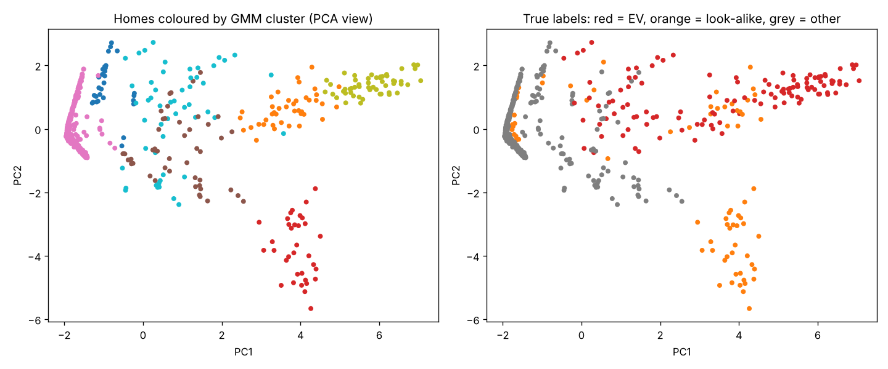

# Detecting Home EV Charging from Smart Meter Data

A practice project: can we find which households charge an electric vehicle (EV) at home, and how many there are, using **only hourly smart meter readings** and **unsupervised clustering**?

Real smart meter data is private, so this project **generates realistic synthetic data** for 630 Ontario-style homes over one year (600 general homes plus 30 extra homes that charge an EV almost every night), hides the true answers, then tries to recover them.

## The idea in one picture


Home EV charging leaves a clear fingerprint in the meter data:

| Signal | Level 2 charger (240 V) | Level 1 charger (120 V) |
|---|---|---|
| Extra power | ~6–7.7 kW | ~1.3–1.9 kW |
| Session length | 2–5 hours | 5–14 hours |
| Timing | evening, or 11 pm on an overnight-rate timer | evening/overnight |
| Shape | flat "block" that switches on and off sharply | long, low, flat block |
| Frequency | some nights, not others (or every night, see below) | some nights, not others |
| Season | all year | all year |

The hard part is **look-alikes**: hot tubs, electric water heaters and electric baseboard heating also add big blocks of load.

## Data (synthetic)

`src/generate_data.py` simulates, for each home:

* a daily routine (morning and evening peaks, weekday vs weekend),
* heating and air conditioning driven by a synthetic Toronto temperature series,
* random appliance spikes (oven, dryer),
* **EV charging for ~15% of homes** (70% Level 2, 30% Level 1; ~55% use an 11 pm timer for the Ultra-Low Overnight price),
* **look-alike loads for ~15% of homes** (water heater, hot tub, baseboard heating),
* **30 extra every-night chargers** (23 Level 2, 7 Level 1): they plug in on 85–100% of nights and top up only what that day's driving used (Level 2: usually 1–3 h), either starting at 11 pm on a timer or finishing at a set departure time (6 or 7 am). They come from their own random stream, so the first 600 homes are identical with or without them (`--every-night-homes 0` reproduces the original 600-home data).

Outputs (in `data/`, not committed):

| File | Contents |
|---|---|
| `meter_readings.csv.gz` | `home_id, timestamp, kwh` (hourly, 5.52 M rows) |
| `homes.csv` | hidden truth: `has_ev`, `charger_level`, `charging_pattern` (some_nights / every_night), `charge_timing`, `lookalike` |
| `ev_sessions.csv` | hidden truth: every charging session |
| `weather.csv` | hourly temperature |

## Method

1. **Compare every hour with the home's own normal.** For each home, compute its median load for each hour of the day, then the *excess* above that. (This hides homes that charge almost every night; see [Every-night chargers](#every-night-chargers-a-blind-spot-of-the-typical-load-baseline).)
2. **Find blocks.** Runs where the excess stays ≥ 3.5 kW for ≥ 2 h ("big", Level-2-like) or ≥ 1.1 kW for ≥ 4 h ("small", Level-1-like).
3. **Describe each home with 12 features** (`src/features.py`): how often blocks happen, their power and length, how flat they are, whether they start in the evening/night, how *consistent* the start time is, whether they cluster in winter, and how strongly night-time use tracks cold weather.
4. **Cluster homes** (`src/detect.py`) with K-Means and a Gaussian Mixture Model (GMM) on the standardised features.
5. **Name each cluster** from its typical (median) home using physical rules of thumb (e.g. "~6 kW blocks starting at a consistent time → Level 2 EV").
6. **Score against the hidden truth** (labels are used only here, never for training).

A **baseline** clusters each home's *average daily load shape*. It is the obvious first idea, but averaging a year of data blurs out charging that only happens some nights.

## Results (630 homes, 120 with an EV)

| Method | Precision | Recall | F1 | Homes flagged | True EV homes |
|---|---|---|---|---|---|
| Baseline: K-Means on average daily profile | 1.00 | 0.34 | 0.51 | 41 | 120 |
| Features + K-Means (k = 7) | 0.84 | 0.85 | 0.85 | 121 | 120 |
| Features + Gaussian Mixture (k = 7) | 0.77 | 0.93 | 0.84 | 146 | 120 |

What the GMM found:

| Cluster (median home) | Homes | Named as | Who is really in it |
|---|---|---|---|
| ~6.1 kW blocks, start time spread 0.4 h, 25% in winter | 53 | EV (Level 2) | 53 Level 2 EVs |
| ~5.0 kW blocks on 14% of days, start spread 0.7 h | 41 | EV (Level 2) | 9 Level 2 EVs, 15 every-night Level 2 EVs, **17 hot tubs** |
| long ~1.1–2 kW blocks, start spread 2.4 h | 52 | EV (Level 1) | 35 Level 1 EVs (incl. 7 every-night), 4 hot tubs, 13 homes without an EV |
| blocks mostly in winter, night load tracks cold (r = −0.96) | 34 | Electric heating | 34 baseboard heating |
| no blocks | 450 | Typical homes (3 clusters) | incl. **8 every-night Level 2 EVs** |



**Takeaways**

* Engineered, physically meaningful features beat clustering raw daily shapes (F1 0.84–0.85 vs 0.51).
* Every Level 1 home and every some-nights Level 2 home was found by the GMM, with no false alarms from electric heating.
* The main confusion is **Level 2 chargers vs hot tubs** (both ~4–6 kW night blocks): 21 of 22 hot tubs are flagged. Every-night chargers make this worse because they, like hot tubs, add load almost every night.
* Choosing *k* is a judgement call: silhouette scores favour very few clusters, but more clusters separate the look-alikes better. Interpreting cluster profiles matters as much as the algorithm.

## Every-night chargers: a blind spot of the "typical load" baseline

Many EV owners on the Ultra-Low Overnight rate plug in **every night**. Then charging is part of the home's normal night, so the yearly median for 11 pm or 5 am already contains it and the extra-load blocks disappear. `src/compare_baselines.py` measures this and tries four alternatives to the yearly median (`features.BASELINES`):

| Baseline | How "typical load" is defined |
|---|---|
| `median` (original) | median of each hour of day over the year |
| `p20` | 20th percentile of each hour of day over the year |
| `quiet_nights` | median of each hour of day over quiet nights only (largest night hour within 1 kW of the home's 10th percentile) |
| `rolling` | rolling 29-day median of each hour of day |
| `edges` | no baseline: a block starts with a jump of ≥ 1.1 kW and ends when load falls back by half the jump |

**Step 1: does the charging show up at all?** Share of true charging sessions with at least one hour inside a detected block (mean per home):

| Charging pattern | median | p20 | quiet_nights | rolling | edges |
|---|---|---|---|---|---|
| every night, 11 pm timer | 0.06 | 0.14 | 0.16 | 0.06 | 0.32 |
| every night, finish by departure | 0.05 | 0.14 | 0.22 | 0.05 | 0.29 |
| some nights, 11 pm timer | 0.62 | 0.95 | 0.89 | 0.63 | 0.83 |
| some nights, evening | 0.76 | 0.97 | 0.90 | 0.77 | 0.86 |

With the original median, **94–95% of every-night sessions are invisible.** Part of the gap cannot be closed with hourly data: about 40% of every-night Level 2 top-ups last only one hour, shorter than the 2-hour block rule.

**Step 2: are the homes found?** Same features and clustering as above (k = 7):

| Baseline + clustering | Every-night EVs found | Some-nights EVs found | False alarms | F1 (all 120 EVs) |
|---|---|---|---|---|
| median + K-Means (original) | 14 / 30 | 88 / 90 | 19 | 0.85 |
| median + GMM (original) | 22 / 30 | 90 / 90 | 34 | 0.84 |
| p20 + K-Means | **30 / 30** | 90 / 90 | 22 | **0.92** |
| p20 + GMM | 0 / 30 | 61 / 90 | 0 | 0.67 |
| quiet_nights + K-Means | 19 / 30 | 86 / 90 | 18 | 0.86 |
| quiet_nights + GMM | 4 / 30 | 88 / 90 | 3 | 0.86 |
| rolling + K-Means | 10 / 30 | 88 / 90 | 19 | 0.83 |
| rolling + GMM | 5 / 30 | 62 / 90 | 13 | 0.67 |
| edges + K-Means | 29 / 30 | 78 / 90 | 23 | 0.86 |
| edges + GMM | 8 / 30 | 73 / 90 | 13 | 0.76 |

What this says:

* The original method finds every-night chargers only through their few long (heavy-driving) nights: K-Means misses 16 of 30, the GMM misses 8 of 30.
* **Edge detection** makes the most every-night sessions visible (about 30%, vs 6%), because it does not care how often a block happens. The cost is weaker Level 1 detection (slow 1.3–1.9 kW starts are harder to tell from normal evening ramps).
* A **20th-percentile baseline** gave the best single result (p20 + K-Means: all 30 every-night chargers, F1 0.92), but the same features with a GMM fell apart (0 of 30). With these results swinging this much between K-Means and GMM, no baseline is a clear winner yet: the cluster-naming step (k = 7, rules on cluster medians) is as much the bottleneck as the baseline. The default pipeline therefore still uses the median; the full tables are in `reports/baseline_comparison*.csv` and `reports/baseline_session_visibility.csv`.
* Most of the remaining false alarms are hot tubs, which, like every-night chargers, add a block of load almost every night.

## Run it

```bash
pip install -r requirements.txt
./run_all.sh          # ~1 minute: generate data, cluster, compare baselines, write reports/
```

Outputs in `reports/`: `results.csv`, `results_by_home_type.csv`, `cluster_profiles_gmm.csv`, `home_features.csv`, `home_predictions.csv`, `baseline_comparison.csv`, `baseline_comparison_by_type.csv`, `baseline_session_visibility.csv`, figures.

`python3 src/detect.py --baseline p20` runs the main pipeline with another baseline.

## Next steps

* **Every-night chargers**: make the decision step more stable (e.g. score each home directly, or check several seeds and k values), and try combining the 20th-percentile baseline with edge detection.
* **Session-level detection**: count charging sessions and kWh per home (useful for grid planning, e.g. how much EV load lands at 11 pm).
* Add features for **energy per block** and **night-to-night variability** to split EVs from hot tubs.
* Try **DBSCAN/HDBSCAN** (no need to choose *k*) and **semi-supervised** labelling with a few known EV owners.
* Test on **15-minute** data, where charger on/off edges are much sharper.
* Real-data issues: missing reads, daylight-saving shifts, solar panels (negative net load), multiple EVs per home.
