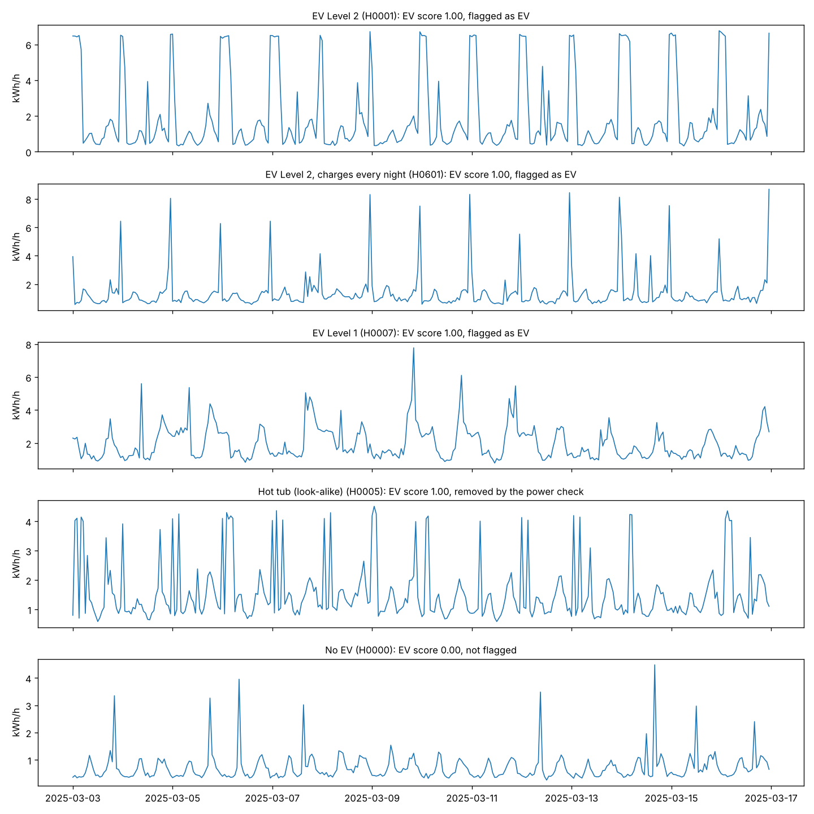
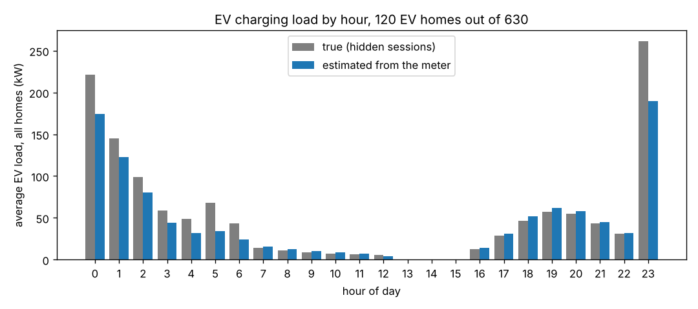

# Detecting Home EV Charging from Smart Meter Data

A practice project: can we find which households charge an electric vehicle (EV) at home, and how many there are, using **only hourly smart meter readings** and **unsupervised clustering**?

Real smart meter data is private, so this project **generates realistic synthetic data** for 630 Ontario-style homes over one year (600 general homes plus 30 extra homes that charge an EV almost every night), hides the true answers, then tries to recover them.

## The idea in one picture



Home EV charging leaves a clear fingerprint in the meter data:

| Signal | Level 2 charger (240 V) | Level 1 charger (120 V) |
|---|---|---|
| Extra power | ~6–7.7 kW | ~1.3–1.9 kW |
| Session length | 2–5 hours | 5–14 hours |
| Timing | evening, or 11 pm on an overnight-rate timer | evening/overnight |
| Shape | flat "block" that switches on and off sharply | long, low, flat block |
| Frequency | some nights, not others (or every night, see below) | some nights, not others |
| Season | all year | all year |

The hard part is **look-alikes**: hot tubs, electric water heaters and electric baseboard heating also add big blocks of load.

## Data (synthetic)

`src/generate_data.py` simulates, for each home:

* a daily routine (morning and evening peaks, weekday vs weekend),
* heating and air conditioning driven by a synthetic Toronto temperature series,
* random appliance spikes (oven, dryer),
* **EV charging for ~15% of homes** (70% Level 2, 30% Level 1; ~55% use an 11 pm timer for the Ultra-Low Overnight price),
* **look-alike loads for ~15% of homes** (water heater, hot tub, baseboard heating),
* **30 extra every-night chargers** (23 Level 2, 7 Level 1): they plug in on 85–100% of nights and top up only what that day's driving used (Level 2: usually 1–3 h), either starting at 11 pm on a timer or finishing at a set departure time (6 or 7 am). They come from their own random stream, so the first 600 homes are identical with or without them (`--every-night-homes 0` reproduces the original 600-home data).

Outputs (in `data/`, not committed):

| File | Contents |
|---|---|
| `meter_readings.csv.gz` | `home_id, timestamp, kwh` (hourly, 5.52 M rows) |
| `homes.csv` | hidden truth: `has_ev`, `charger_level`, `charging_pattern` (some_nights / every_night), `charge_timing`, `lookalike` |
| `ev_sessions.csv` | hidden truth: every charging session |
| `weather.csv` | hourly temperature |

## Method

1. **Compare every hour with the home's own normal.** For each home, compute its typical load for each hour of the day, then the *excess* above that. The default (`p20_edges`) takes, hour by hour, the larger of (a) the excess over the home's 20th-percentile load for that hour and (b) the excess after a sudden jump of ≥ 1.1 kW, until the load falls back. The first version used the yearly median, which hides homes that charge almost every night; see [Every-night chargers](#every-night-chargers-a-blind-spot-of-the-typical-load-baseline).
2. **Find blocks.** Runs where the excess stays ≥ 3.5 kW for ≥ 2 h ("big", Level-2-like) or ≥ 1.1 kW for ≥ 4 h ("small", Level-1-like).
3. **Describe each home with 12 clustering features** (`src/features.py`): how often blocks happen, their power and length, how flat they are, whether they start in the evening/night, how *consistent* the start time is, whether they cluster in winter, and how strongly night-time use tracks cold weather. Three more per-block features are computed for the power check in step 7: the typical highest hour of a block (`big_block_peak_kw`), the energy per block (`big_block_kwh`) and how much block energy changes from night to night (`big_block_night_kwh_cv`).
4. **Cluster homes** (`src/detect.py`) with K-Means on the standardised features.
5. **Name each cluster** from its typical (median) home using physical rules of thumb (e.g. "~6 kW blocks starting at a consistent time → Level 2 EV").
6. **Vote instead of trusting one run.** Steps 4–5 are repeated for k = 5–9 clusters and 5 random seeds (25 runs). Each home's **EV score** is the share of runs that put it in an EV cluster; a home is flagged when the score is at least 0.5. The estimated number of EV homes is the number flagged.
7. **Charger power check.** A flagged home that has Level-2-like blocks on at least 3% of days must reach charger power in them: its typical block peak must be at least 5.5 kW. Level 2 chargers on a 24–32 A circuit draw 5.8–7.7 kW; most hot tub heaters draw 4–5.5 kW. Level 1 homes almost never have such blocks, so they are not affected. See [Hot tubs vs Level 2 chargers](#hot-tubs-vs-level-2-chargers).
8. **Score against the hidden truth** (labels are used only here, never for training).

A **baseline** clusters each home's *average daily load shape*. It is the obvious first idea, but averaging a year of data blurs out charging that only happens some nights. The first version of this project (median baseline, one K-Means or GMM run with k = 7) is kept as a comparison.

## Results (630 homes, 120 with an EV)

| Method | Precision | Recall | F1 | Homes flagged | True EV homes |
|---|---|---|---|---|---|
| Baseline: K-Means on average daily profile | 1.00 | 0.34 | 0.51 | 41 | 120 |
| First version: median features + K-Means (k = 7) | 0.84 | 0.85 | 0.85 | 121 | 120 |
| First version: median features + GMM (k = 7) | 0.77 | 0.93 | 0.84 | 146 | 120 |
| p20_edges features + K-Means (k = 7, one run) | 0.86 | 0.98 | 0.92 | 138 | 120 |
| p20_edges features + K-Means vote (k = 5–9, 25 runs) | 0.85 | 0.98 | 0.91 | 139 | 120 |
| same vote, 3 block features added to the clustering | 0.85 | 0.97 | 0.91 | 136 | 120 |
| **Default: K-Means vote + charger power check (peak ≥ 5.5 kW)** | **1.00** | **0.98** | **0.99** | **118** | **120** |
| Rules only, no clustering (same thresholds) | 0.98 | 0.99 | 0.99 | 121 | 120 |

The default finds 118 of the 120 EV homes with no false alarms, so the estimated count (118) is now close to the true 120. Flagged by home type:

| Home type | Homes | Flagged (default) | Vote only (before the power check) | First-version GMM |
|---|---|---|---|---|
| EV Level 2, some nights | 62 | 62 | 62 | 62 |
| EV Level 2, every night | 23 | 21 | 21 | 15 |
| EV Level 1, some nights | 28 | 28 | 28 | 28 |
| EV Level 1, every night | 7 | 7 | 7 | 7 |
| Hot tub | 22 | **0** | 21 | 21 |
| Electric water heater | 17 | 0 | 0 | 0 |
| Baseboard heating | 34 | 0 | 0 | 0 |
| No EV, no look-alike | 437 | 0 | 0 | 13 |

The EV score (from the vote, before the power check) is clear-cut for most homes: 119 homes are flagged in all 25 runs, 486 in none, and only 25 fall in between (mostly Level 1 chargers at 0.8, flagged in every run except k = 5, and four water heaters at 0.04–0.2).

What one K-Means run (k = 7) on the default features finds:

| Cluster (median home) | Homes | Named as | Who is really in it |
|---|---|---|---|
| ~6.3 kW blocks on 42% of days, 3.2 h long, start spread 0.5 h | 103 | EV (Level 2) | 62 Level 2 EVs, 21 every-night Level 2 EVs, **20 hot tubs** |
| long ~1.1–2 kW blocks on 53% of days, start spread 1.5 h | 35 | EV (Level 1) | 35 Level 1 EVs (incl. 7 every-night), nothing else |
| blocks of ~45 h, night load tracks cold (r = −0.96) | 34 | Electric heating | 34 baseboard heating |
| few blocks, mostly in winter (74–75%) | 178 | Electric heating (2 clusters) | 176 homes without an EV, 1 water heater, 1 every-night Level 2 EV |
| no or rare blocks | 280 | Typical homes (2 clusters) | 261 homes without an EV, 16 water heaters, 2 hot tubs, 1 every-night Level 2 EV |

The naming rules call two clusters of ordinary homes "electric heating" because their few blocks fall in winter. That label is wrong but harmless here: those clusters are not EV clusters, so it does not change who is flagged. Full tables: `reports/cluster_profiles_kmeans.csv` and `reports/cluster_members_kmeans.csv`.


**Takeaways**

* Engineered, physically meaningful features beat clustering raw daily shapes (F1 0.99 vs 0.51).
* The default finds 28 of 30 every-night chargers (the first-version K-Means found 14) and all 90 some-nights chargers, and the Level 1 cluster is pure: no false alarms from homes without an EV.
* Clustering alone puts **hot tubs** in the Level 2 EV cluster (21 of 22 flagged by the vote): like a charger they add a flat block at night. The charger power check removes all 21 without losing an EV, so the estimated count drops from 139 to 118 (true: 120).
* The two missed homes are every-night Level 2 chargers whose top-ups are mostly 1 hour long, shorter than the 2-hour block rule.
* Choosing *k* is a judgement call (silhouette is highest at k = 7 among k = 2–9, 0.40, but close for 2, 6 and 8). The vote over k = 5–9 removes the need to pick one.

## Hot tubs vs Level 2 chargers

Before the power check, every false alarm was a hot tub. Three per-block features were added to tell them apart (medians per home, from `reports/home_features.csv`):

| Home type | Block peak kW (min – median – max) | kWh per block (min – median – max) | Night-to-night variability of block energy (CV, min – median – max) |
|---|---|---|---|
| EV Level 2, some nights | 6.08 – 7.10 – 8.59 | 19.7 – 22.4 – 27.1 | 0.30 – 0.33 – 0.39 |
| EV Level 2, every night | 5.99 – 6.75 – 8.04 | 10.9 – 12.6 – 14.1 | 0.18 – 0.29 – 0.35 |
| Hot tub | 3.69 – 4.17 – 5.22 | 7.3 – 8.5 – 11.1 | 0.00 – 0.33 – 0.37 |

What this says:

* **Power separates them; variability does not.** No hot tub reaches a 5.5 kW block peak and no Level 2 EV stays below 5.99 kW. Night-to-night variability is about the same for both (CV ~0.3): a hot tub heater cycles at random, so its nightly energy changes as much as a driver's. Energy per block separates some-nights chargers, but every-night top-ups (11–14 kWh) overlap with large hot tubs (up to 11 kWh).
* **Adding the features to the clustering is not enough.** With all three as extra clustering features, the vote still flags 20 hot tubs (and loses 2 EVs): 22 hot tubs are too few to form their own cluster among 630 homes. A simple rule after the clustering works better: a flagged home with regular Level-2-like blocks must reach charger power.
* **The 5.5 kW threshold is not fragile** (`reports/power_check_sensitivity.csv`): 5.0 kW leaves 3 hot tubs flagged, 5.5 kW and 6.0 kW leave none (6.0 kW loses one every-night EV), 6.5 kW loses 19 EVs. Changing the 3% block-rate gate to 1% gives the same result; 5% lets one hot tub back in.
* **Honest limit:** in this synthetic data, Level 2 chargers are 6–7.7 kW and hot tubs 3–5 kW, so the two power ranges do not overlap. Real homes have 16 A Level 2 chargers (~3.8 kW) and some 5.5–6 kW hot tub heaters; those cases would be missed or mixed up by a power rule alone.

## Rules only vs clustering

The thresholds that name the clusters can also be used on their own, home by home, with no clustering (`rules_only` in `src/detect.py`): Level-2-like blocks on at least 3% of days that peak at ≥ 5.5 kW and start at a consistent time, or long low blocks on at least 8% of days that start at a consistent time and are not winter-only. On this data that does as well as the clustering (F1 0.99: 121 flagged, 119 of 120 EVs, 2 hot tubs).

That result is flattering: the thresholds were chosen knowing how the simulator works. On real meter data the power ranges of chargers and look-alikes are not known in advance. Clustering finds the groups first (including look-alikes nobody listed); thresholds then name and clean them, and should be checked on a few homes with a known EV.

## Stress test: low-power chargers and bigger hot tubs

The power check works here because chargers (6–7.7 kW) and hot tubs (3–5 kW) never overlap. `./run_hard_test.sh` re-generates the same homes with every third Level 2 charger made a 16 A unit (3.3–3.8 kW; 26 of 85 Level 2 homes) and hot tub heaters at 4.5–6.5 kW, and writes the results to `reports/hard_test/`.

| Method (hard data) | Precision | Recall | F1 | Homes flagged | Hot tubs flagged | 16 A chargers found |
|---|---|---|---|---|---|---|
| K-Means vote (no power check) | 0.84 | 0.98 | 0.91 | 140 | 22 / 22 | 26 / 26 |
| Default: vote + power check (5.5 kW) | 0.88 | 0.77 | 0.82 | 104 | 12 / 22 | **0 / 26** |
| Rules only | 0.91 | 0.97 | 0.94 | 128 | 12 / 22 | 23 / 26 |

What this says:

* **The power check breaks when power overlaps.** It removes every 16 A charger (block peak 3.7–5.3 kW) and still lets 12 of 22 hot tubs through (block peak 4.6–6.7 kW). No single kW threshold fixes it (`reports/hard_test/power_check_sensitivity.csv`: 4.5 kW keeps all 22 hot tubs, 6.0 kW still keeps 7 and loses more EVs).
* The rules-only detector does better here only because its Level 1 rule (long blocks ≥ 1.1 kW) happens to catch the long sessions of slow Level 2 chargers.
* Separating slow chargers from hot tubs needs a feature that is not power: e.g. hot tub heaters switch on and off within a night (many 1-hour bursts), while a charger runs one continuous session; or a few labelled homes.

## EV load by hour (sessions and kWh)

The question behind "how many homes charge an EV" is usually "how much load, and when". `src/sessions.py` takes every flagged home, treats each of its charging blocks as one session and its excess load as EV load, and compares with the hidden session table (`ev_sessions.csv`; true load counted at full charger power for every session hour, so it slightly over-states the last hour).



| | Estimated from the meter | True |
|---|---|---|
| Hour with the most EV load | 23:00 | 23:00 |
| Average EV load at 23:00, all 630 homes | 189 kW | 261 kW |
| Share of daily EV energy in the 23:00 hour | 17.9% | 20.5% |
| EV energy over the year | 385 MWh | ≤ 465 MWh |
| Largest one-hour EV load of the year | 270 kW (28 Jan, 23:00) | 329 kW (same hour) |
| Charging sessions | 19,201 | 26,038 |

What this says:

* The **shape and timing are right**: the 11 pm spike from overnight-rate timers (about one fifth of all EV energy lands in that one hour) and the same peak night of the year.
* The **amount is under-estimated by about 17–28%**, mostly (about 80% of the missing energy) from every-night chargers: their 1-hour top-ups are shorter than the block rule, so only 2,281 of 7,045 every-night Level 2 sessions are found. Some-nights Level 2 sessions are found almost one-for-one (10,487 vs 10,858).
* Files: `reports/ev_load_by_hour.csv`, `reports/ev_sessions_per_home.csv`, `reports/session_summary.json`.

## Every-night chargers: a blind spot of the "typical load" baseline

Many EV owners on the Ultra-Low Overnight rate plug in **every night**. Then charging is part of the home's normal night, so the yearly median for 11 pm or 5 am already contains it and the extra-load blocks disappear. `src/compare_baselines.py` measures this and tries five alternatives to the yearly median (`features.BASELINES`):

| Baseline | How "typical load" is defined |
|---|---|
| `median` (original) | median of each hour of day over the year |
| `p20` | 20th percentile of each hour of day over the year |
| `quiet_nights` | median of each hour of day over quiet nights only (largest night hour within 1 kW of the home's 10th percentile) |
| `rolling` | rolling 29-day median of each hour of day |
| `edges` | no baseline: a block starts with a jump of ≥ 1.1 kW and ends when load falls back by half the jump |
| `p20_edges` | hour by hour, the larger of the `p20` excess and the `edges` excess (keeps both kinds of block) |

**Step 1: does the charging show up at all?** Share of true charging sessions with at least one hour inside a detected block (mean per home):

| Charging pattern | median | p20 | quiet_nights | rolling | edges | p20_edges |
|---|---|---|---|---|---|---|
| every night, 11 pm timer | 0.06 | 0.14 | 0.16 | 0.06 | 0.32 | 0.38 |
| every night, finish by departure | 0.05 | 0.14 | 0.22 | 0.05 | 0.29 | 0.35 |
| some nights, 11 pm timer | 0.62 | 0.95 | 0.89 | 0.63 | 0.83 | 0.96 |
| some nights, evening | 0.76 | 0.97 | 0.90 | 0.77 | 0.86 | 0.99 |

With the original median, **94–95% of every-night sessions are invisible.** Part of the gap cannot be closed with hourly data: about 40% of every-night Level 2 top-ups last only one hour, shorter than the 2-hour block rule.

**Step 2: are the homes found?** Same features and clustering as above (k = 7):

| Baseline + clustering | Every-night EVs found | Some-nights EVs found | False alarms | F1 (all 120 EVs) |
|---|---|---|---|---|
| median + K-Means (original) | 14 / 30 | 88 / 90 | 19 | 0.85 |
| median + GMM (original) | 22 / 30 | 90 / 90 | 34 | 0.84 |
| p20 + K-Means | **30 / 30** | 90 / 90 | 22 | **0.92** |
| p20 + GMM | 0 / 30 | 61 / 90 | 0 | 0.67 |
| quiet_nights + K-Means | 19 / 30 | 86 / 90 | 18 | 0.86 |
| quiet_nights + GMM | 4 / 30 | 88 / 90 | 3 | 0.86 |
| rolling + K-Means | 10 / 30 | 88 / 90 | 19 | 0.83 |
| rolling + GMM | 5 / 30 | 62 / 90 | 13 | 0.67 |
| edges + K-Means | 29 / 30 | 78 / 90 | 23 | 0.86 |
| edges + GMM | 8 / 30 | 73 / 90 | 13 | 0.76 |
| p20_edges + K-Means | 28 / 30 | 90 / 90 | 20 | 0.92 |
| p20_edges + GMM | 22 / 30 | 78 / 90 | 21 | 0.83 |

What this says:

* The original method finds every-night chargers only through their few long (heavy-driving) nights: K-Means misses 16 of 30, the GMM misses 8 of 30.
* **Edge detection** makes the most every-night sessions visible (about 30%, vs 6%), because it does not care how often a block happens. The cost is weaker Level 1 detection (slow 1.3–1.9 kW starts are harder to tell from normal evening ramps).
* A **20th-percentile baseline** gave the best single result (p20 + K-Means: all 30 every-night chargers, F1 0.92), but the same features with a GMM fell apart (0 of 30). Combining it with edge detection (`p20_edges`) makes the most sessions visible of all baselines (35–38% of every-night sessions, 96–99% of some-nights sessions). The full tables are in `reports/baseline_comparison*.csv` and `reports/baseline_session_visibility.csv`.
* Most of the remaining false alarms are hot tubs, which, like every-night chargers, add a block of load almost every night.

### Is one clustering run enough? (stability check)

The tables above come from **one** setting (k = 7, seed 0), and the K-Means/GMM gap suggested that one run can be lucky or unlucky. `src/stability.py` repeats the clustering for every baseline over **k = 5–9 and seeds 0–4** (25 settings × K-Means and GMM = 50 runs) and gives each home an **EV score**: the share of runs that flag it. A home is flagged when its score is at least 0.5 (majority vote).

Spread over the 25 settings (every-night chargers found, out of 30):

| Baseline + clustering | F1 min – median – max | Every-night found min – median – max | Homes flagged min – max |
|---|---|---|---|
| median + K-Means | 0.83 – 0.84 – 0.86 | 12 – 14 – 19 | 117 – 129 |
| median + GMM | 0.67 – 0.79 – 0.92 | 5 – 12 – 30 | 80 – 146 |
| p20 + K-Means | 0.76 – 0.90 – 0.92 | 13 – 27 – 30 | 110 – 142 |
| p20 + GMM | 0.66 – 0.76 – 0.92 | 0 – 10 – 30 | 61 – 147 |
| quiet_nights + K-Means | 0.75 – 0.86 – 0.89 | 18 – 20 – 24 | 100 – 129 |
| quiet_nights + GMM | 0.66 – 0.83 – 0.89 | 0 – 22 – 30 | 63 – 168 |
| rolling + K-Means | 0.68 – 0.82 – 0.86 | 5 – 10 – 18 | 81 – 127 |
| rolling + GMM | 0.67 – 0.70 – 0.77 | 0 – 5 – 23 | 62 – 100 |
| edges + K-Means | 0.83 – 0.86 – 0.89 | 19 – 29 – 29 | 113 – 137 |
| edges + GMM | 0.68 – 0.76 – 0.88 | 0 – 9 – 30 | 62 – 152 |
| **p20_edges + K-Means** | **0.83 – 0.91 – 0.92** | **21 – 28 – 29** | 120 – 144 |
| p20_edges + GMM | 0.61 – 0.83 – 0.88 | 0 – 21 – 28 | 68 – 134 |

Majority vote on the EV score:

| Baseline | Vote over all 50 runs: F1 / every-night | K-Means runs only: F1 / every-night | GMM runs only: F1 / every-night |
|---|---|---|---|
| median | 0.85 / 13 | 0.85 / 14 | 0.85 / 14 |
| p20 | 0.86 / 16 | **0.92 / 30** | 0.76 / 10 |
| quiet_nights | 0.86 / 19 | 0.86 / 19 | 0.88 / 23 |
| rolling | 0.68 / 5 | 0.83 / 10 | 0.67 / 5 |
| edges | 0.84 / 19 | 0.86 / 29 | 0.76 / 9 |
| p20_edges | 0.84 / 23 | **0.91 / 28** | 0.83 / 21 |

What this says:

* **The GMM is the unstable part.** For every baseline, the number of every-night chargers it finds ranges from 0 (5 for the median baseline) to 23–30 depending on k and the seed. K-Means with 50 restarts hardly depends on the seed (F1 changes by at most 0.03 at a fixed k); its spread comes from the choice of k.
* **p20_edges + K-Means is the steadiest strong option**: F1 0.83–0.92 across all settings (median 0.91) and at least 21 of 30 every-night chargers in every run. p20 + K-Means has the best single result but drops to F1 0.76 and 13 every-night chargers at k = 5. Its K-Means vote finds 28 of 30 every-night chargers and all 90 some-nights chargers, with 21 false alarms (F1 0.91).
* Voting over K-Means **and** GMM runs does not help: the unstable GMM runs pull the vote down. The vote is useful within one algorithm, as a way to stop depending on one k.
* The p20_edges K-Means vote flags 139 homes for 120 real EV homes: it finds 118 of the 120, and all 21 false alarms are hot tubs (21 of 22). So the **count** of EV homes is over-estimated by about the number of hot tubs. The charger power check (added later, see [Hot tubs vs Level 2 chargers](#hot-tubs-vs-level-2-chargers)) removes them.
* Chosen default: **`p20_edges` features, K-Means, majority vote over k = 5–9**. `detect.py` now uses it (see [Results](#results-630-homes-120-with-an-ev)); the first-version median runs are kept there as comparison rows.

Outputs: `reports/stability_summary.csv`, `reports/stability_vote.csv`, `reports/stability_runs.csv` (every run) and `reports/stability_home_scores.csv` (EV score of every home).

### HDBSCAN: no k to choose, but a different knob

K-Means and the GMM both need the number of clusters *k*, and the GMM swings a lot with it. **HDBSCAN** is a density-based method: it finds as many clusters as the data supports and leaves homes that fit no dense group as **noise** (never flagged as EV here). It has no random seed; its main setting is `min_cluster_size`, the smallest group that counts as a cluster. `src/hdbscan_compare.py` runs it on the same standardised features with `min_cluster_size` = 5, 10, 15, 20, 30 and 40, names the clusters with the same rules as `detect.py`, and compares it with the GMM (one k = 7 run and the 25-run vote over k = 5–9).

| Features + method | Clusters | Noise homes (EVs in noise) | Precision | Recall | F1 | Flagged | Every-night found | Hot tubs flagged | F1 after power check |
|---|---|---|---|---|---|---|---|---|---|
| median + HDBSCAN (min size 5) | 14 | 57 (34) | 0.97 | 0.63 | 0.77 | 78 | 8 / 30 | 2 | 0.77 |
| median + HDBSCAN (min size 10) | 7 | 67 (22) | 0.86 | 0.80 | 0.83 | 112 | 21 / 30 | 16 | 0.87 |
| median + HDBSCAN (min size 15–40) | 2–5 | 96–205 (37–53) | 0.81–0.82 | 0.50–0.62 | 0.62–0.71 | 74–90 | 7–14 / 30 | 14–16 | 0.66–0.75 |
| median + GMM (k = 7, one run) | 7 | – | 0.77 | 0.93 | 0.84 | 146 | 22 / 30 | 21 | 0.88 |
| median + GMM vote (k = 5–9, 25 runs) | – | – | 0.83 | 0.87 | 0.85 | 125 | 14 / 30 | 20 | 0.89 |
| **p20_edges + HDBSCAN (min size 5)** | 22 | 144 (18) | 0.93 | 0.85 | **0.89** | 110 | 18 / 30 | 8 | **0.92** |
| p20_edges + HDBSCAN (min size 10–30) | 5–8 | 179–295 (46–50) | 0.78–0.83 | 0.58–0.62 | 0.67–0.69 | 84–94 | 9–12 / 30 | 14–19 | 0.74–0.76 |
| p20_edges + HDBSCAN (min size 40) | 3 | 290 (51) | 0.60 | 0.58 | 0.59 | 115 | 8 / 30 | 12 | 0.62 |
| p20_edges + GMM (k = 7, one run) | 7 | – | 0.83 | 0.83 | 0.83 | 121 | 22 / 30 | 21 | 0.91 |
| p20_edges + GMM vote (k = 5–9, 25 runs) | – | – | 0.83 | 0.83 | 0.83 | 119 | 21 / 30 | 20 | 0.90 |
| *Default for reference: p20_edges + K-Means vote + power check* | | | 1.00 | 0.98 | 0.99 | 118 | 28 / 30 | 0 | |

What this says:

* **HDBSCAN removes k but not the tuning.** F1 moves from 0.59 to 0.89 with `min_cluster_size` (p20_edges features), about as much as the GMM moves with k (0.61–0.88). There is no label-free way to tell that 5 is the right value here.
* **Noise is where the EVs get lost.** With the default features HDBSCAN puts 144–295 of the 630 homes in noise, including 18–51 EV homes. Level 1 chargers suffer most: with `min_cluster_size` = 10 none of the 35 Level 1 homes is flagged (`reports/hdbscan_by_home_type.csv`). EV homes are spread out in feature space (different chargers, schedules and driving), so they do not form one dense group.
* As a result HDBSCAN **under-counts** EV homes (74–115 flagged for 120), while the GMM and K-Means over-count because of hot tubs.
* Its best setting (p20_edges, min size 5: F1 0.89, 0.92 after the power check) beats one GMM run and the GMM vote (0.83), but stays well below the default K-Means vote + power check (0.99). **The default does not change.** HDBSCAN's noise label could still be useful as a "this home is unusual, have a look" list, not as the EV decision.

Outputs: `reports/hdbscan_comparison.csv` (every setting, with spreads for the GMM runs) and `reports/hdbscan_by_home_type.csv`.

## Run it

```bash
pip install -r requirements.txt
./run_all.sh          # ~3 minutes: generate data, cluster, compare baselines, check stability, HDBSCAN comparison, EV load by hour, write reports/
./run_hard_test.sh    # optional stress test (16 A chargers, bigger hot tubs) -> reports/hard_test/
```

Outputs in `reports/`: `results.csv`, `results_by_home_type.csv`, `home_predictions.csv` (EV score and flag for every home), `cluster_profiles_kmeans.csv` and `cluster_members_kmeans.csv` (default features, k = 7), `cluster_profiles_gmm.csv` (first-version GMM), `home_features.csv`, `baseline_comparison.csv`, `baseline_comparison_by_type.csv`, `baseline_session_visibility.csv`, `stability_summary.csv`, `stability_vote.csv`, `stability_runs.csv`, `stability_home_scores.csv`, `hdbscan_comparison.csv`, `hdbscan_by_home_type.csv`, figures.

Also: `power_check_sensitivity.csv` (the power check with other thresholds), `ev_load_by_hour.csv`, `ev_sessions_per_home.csv`, `session_summary.json`.

`python3 src/detect.py --baseline median` runs the main pipeline with another baseline; `--threshold 0.8` makes the vote stricter.

## Next steps

* Recover the missing every-night top-ups (1-hour sessions) so the EV energy estimate is not 17–28% low.
* Separate slow (16 A) chargers from big hot tubs in the stress test with a non-power feature, e.g. on/off cycling within a night.
* Try **semi-supervised** labelling with a few known EV owners (HDBSCAN was tried and did not beat the K-Means vote; see above).
* Test on **15-minute** data, where charger on/off edges are much sharper.
* Real-data issues: missing reads, daylight-saving shifts, solar panels (negative net load), multiple EVs per home.
